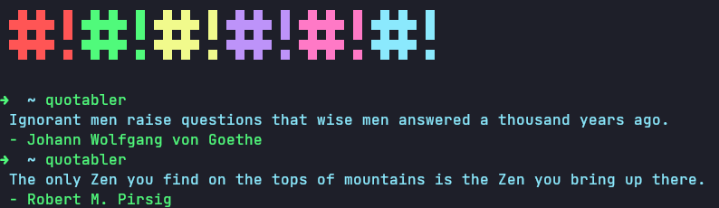

# Quotable

[](https://pkg.go.dev/github.com/UltiRequiem/dadjokes/pkg)



A wrapper and command line tool for the [Quotable](https://github.com/lukePeavey/quotable) quotes API.

## Use your own API server

The public `api.quotable.io` host is no longer available, so point this tool at a Quotable server you run (the
project is open source). The base URL is read, in this order, from:

1. the `-api-url` flag (or the argument of `GetQuotableFrom`),
2. the `QUOTABLE_API_URL` environment variable,
3. the public default, `https://api.quotable.io`.

Give the server address only, without `/random` (a path prefix such as `https://example.com/quotes-api` is fine).

## Usage

```go
import (
	"fmt"
	"github.com/UltiRequiem/quotable/pkg"
)


func main(){
        // the server from QUOTABLE_API_URL (or the default)...
        data, err := quotable.GetQuotable()

        // ...or a specific one
        // data, err := quotable.GetQuotableFrom("https://quotes.example.com")

        if err != nil {
                panic(err)
        }

        fmt.Printf("%s\n -%s\n", data.Content, data.Author)
}
```

## Docs

Is hosted on
[pkg.go.dev](https://pkg.go.dev/github.com/UltiRequiem/quotable/pkg) 📖

## CLI

### Installation

```bash
go install github.com/UltiRequiem/quotable@latest
```

### Usage

```bash
QUOTABLE_API_URL=https://quotes.example.com quotable
```

Or an `X` quantity of times :👇

```bash
quotable -api-url https://quotes.example.com 38
```

Flags go before the number of quotes.

[Video Showcase](https://youtu.be/rfBqpPCBrDE) 📷

## Other Art

I also made this on [JavaScript](https://github.com/UltiRequiem/ranmess),
[Python](https://github.com/UltiRequiem/quoteran),
[a website](https://github.com/UltiRequiem/ulti-random-quotes), and
[Rust](https://github.com/UltiRequiem/ruquotes).

## Licence

Licensed under the MIT License 📄
